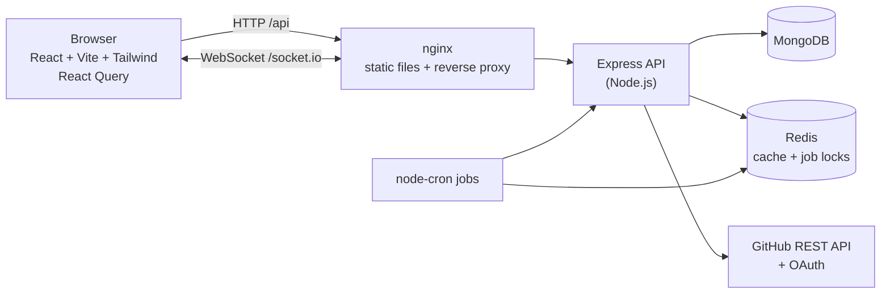
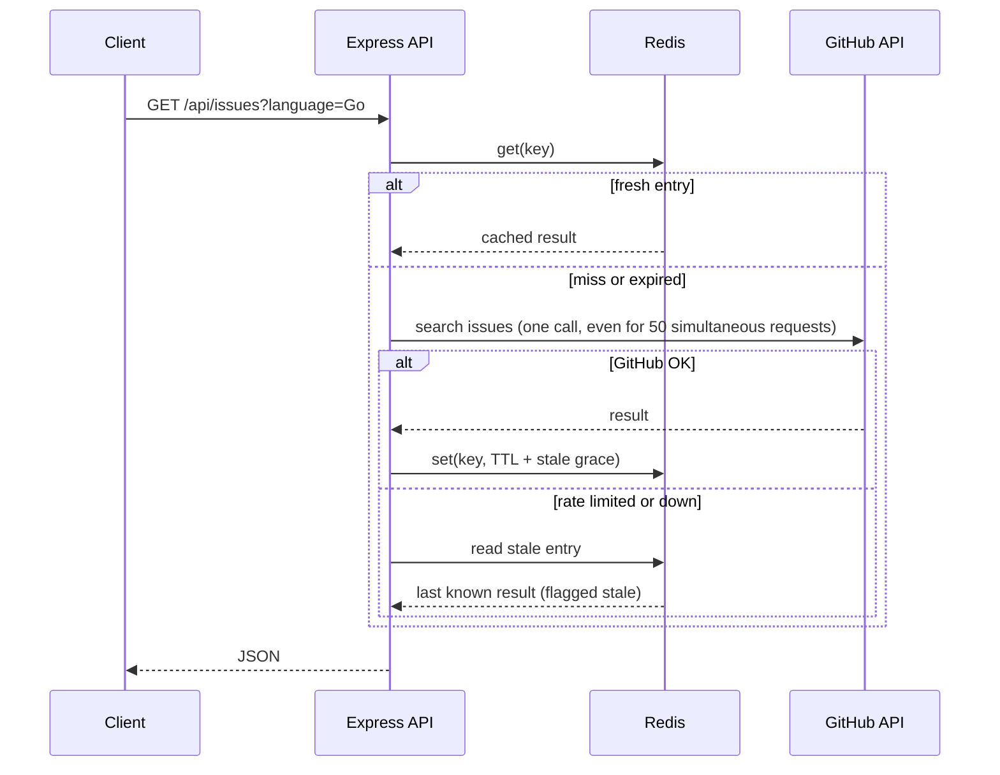
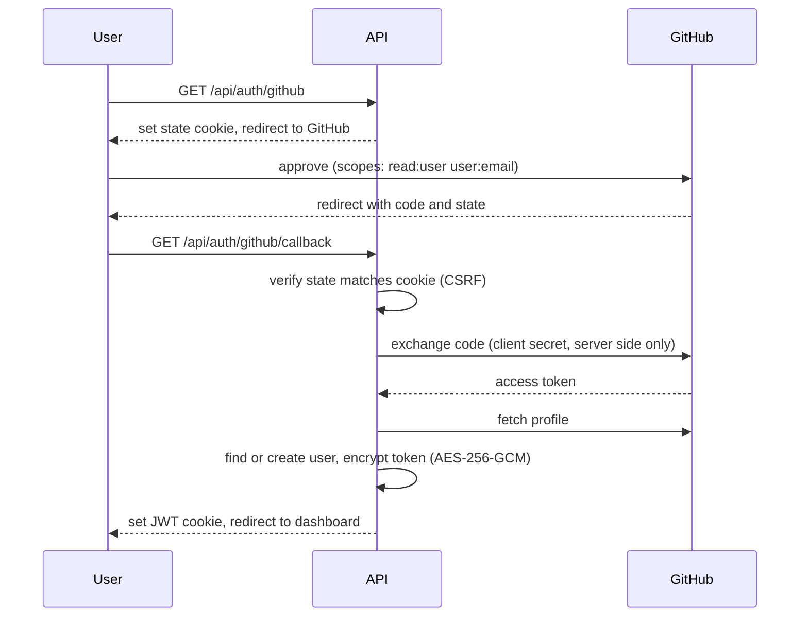
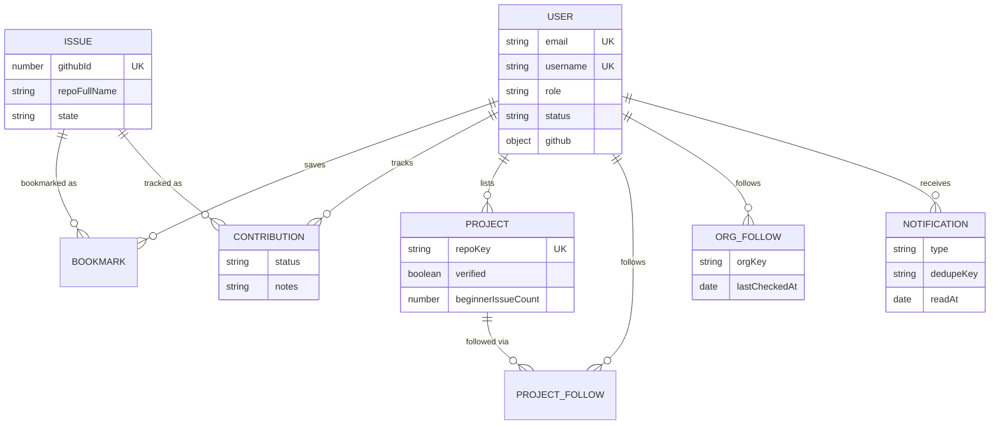

# OpenSourceCompanion

> A platform that helps beginners find their first open-source contribution, track their progress, and showcase verified GitHub activity.

## Problem

Starting in open source is hard. Beginners can't tell which issues are really approachable, GitHub's search can't show how far along they are, and nothing connects the whole journey: find an issue, work on it, open a PR, get it merged.

## Solution

OpenSourceCompanion sits on top of the GitHub API and adds what GitHub lacks for newcomers:

- **Discovery:** search and filter real GitHub issues, with an *estimated* difficulty.
- **Personalization:** a transparent, rule-based feed matched to your skills.
- **Tracking:** a Kanban board for the issues you work on, plus GitHub-verified pull request statistics.
- **Notifications:** get told when a followed organization gets a new issue, or your PR is merged.

## Features

| Area | What you can do |
|---|---|
| **Auth** | Email/password and "Continue with GitHub" (OAuth 2.0), JWT in httpOnly cookies, role-based access (contributor, maintainer, admin) |
| **Explore issues** | Filter by language, labels, organization, repository, difficulty, stars, good first issue, help wanted; sort; paginate; shareable URLs |
| **Difficulty** | Estimated from labels (beginner, intermediate, advanced), always labelled as an estimate |
| **Issue details** | Description, comments, labels, author, bookmark and track actions |
| **Bookmarks** | Save, filter, and sort issues; duplicates impossible |
| **Contribution tracker** | Drag-and-drop Kanban with 7 statuses and notes |
| **Pull requests** | Total, merged, open and closed counts with review status (cached) |
| **Profiles** | Editable bio and skills; GitHub-verified repositories, streaks and badges |
| **Recommendations** | Skill and activity based scoring with an explanation for every suggestion |
| **Dashboard** | Stats, a 13-week activity heatmap, status chart, recommended issues |
| **Projects** | Maintainers list GitHub repositories (verified by ownership), users follow them, project pages show languages, beginner issues, recent activity |
| **Organizations** | Follow a GitHub organization and get notified about new issues |
| **Notifications** | Real-time bell (Socket.io) for new org issues, merged PRs, closed tracked issues |
| **UX** | Responsive, dark and light mode, skeleton loaders, empty and error states, toasts, accessible components |

## Architecture



**Request flow inside the API:** `route → middleware (auth, validation, rate limit) → controller (thin) → service (logic) → model`.

### GitHub caching

The frontend never talks to GitHub. Every call goes through a cache-aside layer that protects the rate limit.



### GitHub OAuth



## Tech stack

| Layer | Technology |
|---|---|
| Frontend | React, Vite, React Router, Tailwind CSS, TanStack Query, Axios, Recharts, Socket.io client |
| Backend | Node.js, Express 5, Mongoose, Zod, JWT, bcrypt, Helmet, express-rate-limit, Socket.io, node-cron |
| Data | MongoDB, Redis |
| Integrations | GitHub REST API, GitHub OAuth |
| Testing | Vitest, Supertest, mongodb-memory-server, React Testing Library |
| DevOps | Docker, Docker Compose, nginx, GitHub Actions |

## Screenshots

| Dashboard | Explore issues |
|---|---|
|  |  |

| Contribution board | Profile |
|---|---|
|  |  |

## API documentation

Base URL: `/api`. All responses use one shape:

```json
{ "success": true, "data": {}, "message": "..." }
{ "success": false, "message": "Issue not found", "errors": [{ "field": "page", "message": "..." }] }
```

Status codes: `200/201` success, `400` validation, `401` not logged in, `403` wrong role or suspended, `404` not found, `409` duplicate, `413` body too large, `429` rate limited (ours or GitHub's), `502` GitHub failure.

Issue search and issue details are public. Recommendations and all other user-specific endpoints require login.

| Area | Endpoint | Notes |
|---|---|---|
| Health | `GET /health` | Status of API, database, cache |
| Auth | `POST /auth/register` | Role is `contributor` or `maintainer` only |
| | `POST /auth/login`, `POST /auth/logout` | JWT in httpOnly cookie |
| | `GET /auth/github`, `GET /auth/github/link`, `GET /auth/github/callback` | OAuth sign-in and "connect GitHub" |
| Users | `GET /users/me`, `PATCH /users/me` | Edit name, bio, skills, location, portfolio, LinkedIn |
| | `GET /users/:username` | Public profile, GitHub stats, badges (allow-listed fields) |
| Issues | `GET /issues` | Filters: `q language repo org labels difficulty goodFirstIssue helpWanted minStars sort page` |
| | `GET /issues/recommended?limit=` | Scored issues with reasons and the weights used |
| | `GET /issues/:owner/:repo/:number` | Detail with comments |
| Bookmarks | `GET /bookmarks`, `POST /bookmarks`, `DELETE /bookmarks/:id` | Body: `{repo, number}` only |
| Contributions | `GET /contributions`, `GET /contributions/stats` | |
| | `POST /contributions`, `PATCH /contributions/:id`, `DELETE /contributions/:id` | Status and notes |
| Pull requests | `GET /pull-requests`, `GET /pull-requests/stats`, `POST /pull-requests/refresh` | Refresh limited to once per 5 minutes |
| Projects | `GET /projects`, `GET /projects/:id` | Search, language, topic, sort, following |
| | `POST /projects` | Maintainer or admin. Body: `{repo}` only |
| | `PATCH /projects/:id`, `DELETE /projects/:id` | Owner or admin |
| | `POST /projects/:id/follow`, `DELETE /projects/:id/follow` | Idempotent |
| Organizations | `GET /orgs/following`, `POST /orgs/following`, `DELETE /orgs/following/:org` | Organizations only, max 20 |
| Notifications | `GET /notifications`, `GET /notifications/unread-count` | |
| | `PATCH /notifications/read-all`, `PATCH /notifications/:id/read` | |
| Dashboard | `GET /dashboard` | Tracker stats, PR stats, 13-week activity |

**Realtime:** Socket.io on `/socket.io`, authenticated with the same cookie. The server emits `notification` to the private room `user:<id>`.

## Database design



Key decisions:
- **`Issue` is a snapshot, not a mirror.** It is created only when someone bookmarks or tracks an issue, and the server fetches the content from GitHub, so it can't be forged. Difficulty is computed on read, never stored.
- **Unique compound indexes** enforce no duplicate bookmarks, tracked issues, or follows at the database level, even under concurrent requests.
- **Follows are separate collections**, not arrays, so there are no unbounded documents and "who follows X?" is an indexed query.
- **Notifications** use a unique `(user, dedupeKey)` index so a job that runs twice can't notify twice, and a TTL index deletes them after 90 days.

## Local setup

Requirements: Node.js 22+, Docker (for MongoDB).

```bash
git clone https://github.com/<you>/opensourcecompanion.git
cd opensourcecompanion

# 1. MongoDB
docker run -d --name osh-mongo -p 27017:27017 -v osh-mongo-data:/data/db mongo:8

# 2. Backend
cd server
cp .env.example .env        # then fill in JWT_SECRET, TOKEN_ENCRYPTION_KEY, GITHUB_TOKEN
npm install
npm run dev

# 3. Frontend (new terminal)
cd client
npm install
npm run dev
```

Open http://localhost:5173. Optional: `npm run seed:projects` in `server/` lists a few well-known repositories.

### GitHub setup

1. **`GITHUB_TOKEN`:** create a fine-grained token with public repository read access and no other permissions.
2. **OAuth (optional):** create an OAuth app with callback `http://localhost:5173/api/auth/github/callback`.

## Environment variables

| Variable | Required | Description |
|---|---|---|
| `MONGODB_URI` | yes | MongoDB connection string |
| `JWT_SECRET` | yes | 32+ characters, signs login tokens |
| `TOKEN_ENCRYPTION_KEY` | yes | 64 hex characters, encrypts GitHub tokens (AES-256-GCM) |
| `GITHUB_TOKEN` | recommended | Server token for public search. Without it GitHub allows far fewer requests |
| `GITHUB_CLIENT_ID`, `GITHUB_CLIENT_SECRET`, `GITHUB_CALLBACK_URL` | for OAuth | GitHub OAuth app |
| `CLIENT_URL` | no | Frontend origin for CORS and redirects (default `http://localhost:5173`) |
| `PORT` | no | Default `5000` |
| `REDIS_URL` | no | Enables the Redis cache and job locks. Without it, memory is used |
| `TRUST_PROXY` | no | Number of proxies in front of the API (`1` behind nginx) |
| `COOKIE_SECURE` | no | Defaults to `true` in production. Set `false` only for plain-http demos |
| `COOKIE_SAME_SITE` | no | `lax`, `strict`, or `none`; defaults to `lax` locally and `none` in production for split frontend/API hosts. Unsafe API requests must match `CLIENT_URL` |
| `VITE_API_URL` | for separately hosted client | API origin, e.g. `https://your-server.onrender.com` (no `/api` suffix). Set as a client build environment variable; omit when a same-origin proxy handles `/api` |

For separate Render services, set `VITE_API_URL` on the client service to the server's public origin, and set the server's `CLIENT_URL` to the client's public origin. The client build uses `VITE_API_URL` for both HTTP requests and Socket.IO.

Generate secrets with `openssl rand -hex 32`. Never commit `.env`.

## Docker

```bash
cp .env.example .env     # fill in the secrets
docker compose up --build
```

Open http://localhost:8080. Only the frontend port is published. The API, MongoDB and Redis are reachable only inside the Compose network, and nginx proxies `/api` and `/socket.io`.

## Testing

```bash
cd server && npm test        # API, services, jobs, security (Vitest, Supertest, in-memory MongoDB)
cd client && npm test        # components and pages (Vitest, Testing Library)
```

The backend suite covers registration, login, sessions, role-based authorization, bookmarks, contribution tracking, issue retrieval, projects, profiles, notifications, background jobs, caching, scoring, and invalid or malicious input. GitHub is always mocked.

## CI/CD

On every push and pull request, GitHub Actions:

1. Server: install, lint, test
2. Client: install, lint, test, build
3. Build both Docker images

The workflow fails if any step fails.

## Security

- Passwords hashed with bcrypt, uniform login errors, and a dummy comparison to hide which emails exist
- JWT in httpOnly, SameSite cookies, and the user's role and status are re-checked from the database on every request
- GitHub OAuth with CSRF `state`, least-privilege scopes, and tokens encrypted at rest
- Backend authorization on every protected route (the UI only mirrors it)
- Zod validation strips unknown fields and rejects non-string input (mass assignment and NoSQL injection)
- Helmet, strict CORS, body size limit, global and per-user rate limits
- GitHub content rendered as plain text, and links built by the server (XSS-safe)
- Search input escaped and quoted before it reaches MongoDB regexes or GitHub queries

## Design decisions and limitations

- **Difficulty is an estimate** inferred from labels. GitHub has no difficulty field.
- **GitHub search limits:** at most 1,000 results per query, and `minStars` and the "advanced" difficulty filter apply to each page after GitHub returns it.
- **Notifications for org issues arrive within about 15 minutes**, because they come from a polling job rather than webhooks.
- **Streaks cover at most 90 days**, a GitHub events limit.
- **Socket.io is single instance.** Scaling the API out needs the Redis adapter.
- **Rate-limit counters are per instance** (a Redis-backed store would share them).

## Future improvements

- Admin dashboard (the `admin` role already exists), user suspension UI, and moderation
- Leaderboard with a spam-resistant score, and global search
- Maintainer contribution opportunities with applications
- GitHub webhooks for instant notifications
- Redis adapter for Socket.io and Redis-backed rate limits
- Machine-learning recommendations (scoring is isolated in one module for this)
- Email and web-push notifications

## Project structure

```text
opensourcecompanion/
├── client/                 # React app (pages, components, hooks, api, context)
├── server/
│   ├── src/                # config, routes, controllers, services, models, jobs, sockets
│   ├── scripts/            # seed and manual job runner
│   └── tests/
├── .github/workflows/ci.yml
├── docker-compose.yml
└── README.md
```

## License

MIT
